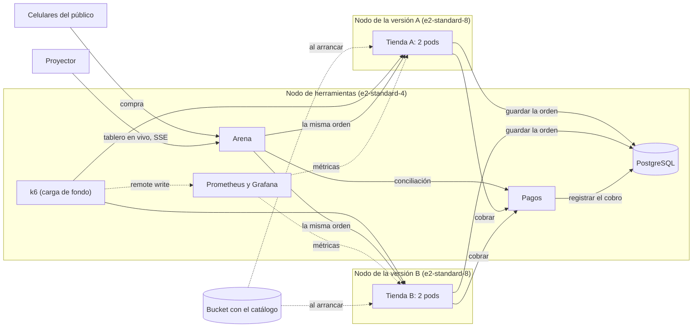
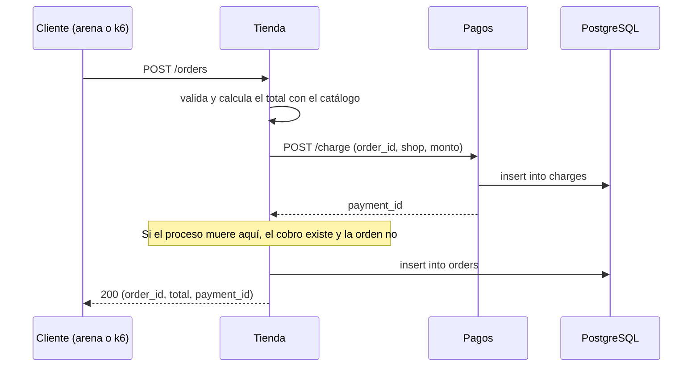

# Arquitectura de la demo

Cómo está armada la demo de "Misma app, dos resultados distintos": qué componentes hay, cómo se hablan, dónde corre cada uno y con qué tecnologías. Los números medidos y cómo reproducirlos están en el [README](README.md).

## La idea

Una sola aplicación (`app/app.py`) se empaqueta y despliega de dos maneras. El código Python es idéntico en las dos; solo cambian el Dockerfile y la forma de arrancar el proceso. Las dos reciben la misma carga, con los mismos recursos, en máquinas iguales y separadas, y se comparan en vivo.

- **Versión A** (`deploy/bad/`): como en muchos tutoriales.
- **Versión B** (`deploy/good/`): con las prácticas de la charla.

## Componentes

| Componente | Qué hace | Tecnología | Dónde corre |
|---|---|---|---|
| Tienda (`app/`) | API con catálogo y órdenes. Es la app que se despliega de dos maneras | FastAPI, pandas, asyncpg, httpx | 2 pods por versión, cada versión en su propio nodo |
| Pagos (`payments/`) | Simula una pasarela externa: tarda ~150 ms, registra cada cobro y concilia cobros contra órdenes | FastAPI, asyncpg | 2 pods en el nodo de herramientas |
| Base de datos (`db/`) | Tablas `orders` (la tienda) y `charges` (pagos) | PostgreSQL 17 con CloudNativePG | 1 instancia en el nodo de herramientas |
| Arena (`arena/`) | Manda cada compra del público a las dos versiones a la vez y muestra el resultado por versión | FastAPI, httpx, Server-Sent Events, HTML estático | 1 pod en el nodo de herramientas |
| Carga (`k6/`) | Tráfico de fondo igual para las dos versiones: 30% órdenes, 70% lecturas | k6 | Job en el nodo de herramientas |
| Observabilidad (`k8s/monitoring-values.yaml`, `k8s/dashboard.json`) | Métricas de contenedores, del cluster y de k6, con un tablero A contra B | Prometheus, Grafana, kube-state-metrics | nodo de herramientas |
| VM (`infra/vm.tf`) | La versión A sin contenedor, para contrastar con el pod | Debian 13, pip, gunicorn, systemd | 1 VM del mismo tipo que los nodos de las versiones |
| Deck (`slides/`) | Las slides, con los paneles de Grafana y el tablero de la arena incrustados | Slidev, Vue | el notebook de quien presenta |

## Cómo se conectan

Cada versión tiene su propio nodo, con un taint que impide que entre cualquier otra carga. Así ninguna le quita CPU ni memoria a la otra, y `os.cpu_count()` dentro de los pods devuelve los 8 núcleos de esa máquina.

## El camino de una orden

La tienda cobra primero y guarda la orden después. Si el proceso recibe un SIGKILL entre los dos pasos, queda un cobro sin orden. `GET /reconciliation` en pagos cuenta esos casos por versión con una sola consulta sobre las dos tablas; la arena lo consulta cada segundo y lo muestra como "cobradas sin orden".

## Las dos versiones

| | Versión A (`deploy/bad/`) | Versión B (`deploy/good/`) |
|---|---|---|
| Imagen base | `python:3.13` completa | `python:3.13-slim`, en dos etapas |
| Dependencias | `pip install -r requirements.txt`, después de copiar el código | `uv sync --frozen` con lockfile, antes de copiar el código |
| Orden de capas | el código invalida la capa de dependencias | las dependencias quedan en su propia capa |
| Usuario | root | UID 1000 |
| Arranque | `CMD ./start.sh` en forma shell; `start.sh` no hace `exec` | `CMD ["uvicorn", ...]` en forma exec |
| Procesos | gunicorn con `cpu_count() * 2 + 1` workers | 1 proceso de uvicorn |
| Bytecode | se compila al importar | precompilado en la build |

El manifiesto de Kubernetes es el mismo para las dos (`k8s/demo.yaml`): 2 réplicas, 1 CPU y 2 GiB por pod, el mismo readiness probe, `preStop` de 15 s y 40 s de gracia. Solo cambian el nombre, la imagen, el nodo y la cuenta de servicio.

## La arena

- **Celular (`/`)**: una tienda con productos reales del catálogo y un botón de compra. Cada toque muestra un recibo por versión.
- **Proyector (`/screen`)**: un tablero por versión con órdenes confirmadas, errores, órdenes por segundo, p95 y cobradas sin orden. Se actualiza por Server-Sent Events.
- **Control (`/admin`)**: carga automática y reinicio de contadores, protegido con un token que la arena imprime al arrancar.
- **Límites**: 5 compras por segundo por dispositivo y 300 por segundo en total.

## Infraestructura

Todo lo de Google Cloud está en OpenTofu (`infra/`). La variable `stage` enciende o apaga lo que cuesta dinero.

| Recurso | Para qué |
|---|---|
| Red y subred propias | rangos separados para nodos, pods y servicios |
| Cluster GKE zonal | un pool por versión (`e2-standard-8`, con taint) y un pool de herramientas (`e2-standard-4`) |
| Artifact Registry | las imágenes |
| Bucket del catálogo | el CSV que las tiendas leen al arrancar |
| Workload Identity | las cuentas de Kubernetes de cada tienda leen el bucket sin llaves |
| VM y su regla de firewall | la versión A sin contenedor; solo el cluster puede llegar a su puerto 8000 |
| Bootstrap (`infra/bootstrap/`) | proyecto, APIs, bucket de estado y presupuesto, para partir desde cero |

Dos cosas las crea el cluster y no OpenTofu: el disco persistente de 10 GiB de PostgreSQL y los releases de Helm (Prometheus y Grafana, CloudNativePG). `make down` borra el namespace antes de apagar el cluster para no dejar el disco huérfano.

Nada queda expuesto a internet por defecto. Grafana, Prometheus y la arena se ven desde el notebook con `make proxy`. Para los celulares, `make tunnel` abre un túnel público solo hacia la arena.

## Despliegue

`make up` hace, en orden:

1. `tofu apply`: red, cluster y pools.
2. Construye las imágenes y las sube a Artifact Registry.
3. Instala Prometheus y Grafana, y el operador de CloudNativePG, con Helm.
4. Aplica PostgreSQL y espera a que esté listo.
5. Aplica pagos, las dos versiones de la tienda y la arena.

Para probar sin cluster, `make local` levanta lo mismo en Podman: PostgreSQL, pagos, dos réplicas por versión con un balanceador delante y la arena.

## Observabilidad

| Fuente | Qué aporta |
|---|---|
| cAdvisor (kubelet) | memoria, CPU, CPU throttling y procesos muertos por OOM de cada contenedor |
| kube-state-metrics | réplicas listas y reinicios |
| k6, por remote write | requests correctas, errores y latencia p95 por versión, vistas desde el cliente |
| Arena | órdenes confirmadas, errores y cobradas sin orden, vistas desde el público |

El tablero de Grafana (`k8s/dashboard.json`) muestra cada métrica como A contra B. Las slides incrustan paneles sueltos de ese tablero y, si el cluster no responde, muestran una captura.

## Tecnologías

| Área | Tecnología | Versión |
|---|---|---|
| Lenguaje | Python | 3.13 |
| API | FastAPI, pydantic | 0.162, 2.14 |
| Servidor | uvicorn; gunicorn con uvicorn-worker en la versión A | 0.54; 26.2 |
| Datos en memoria | pandas | 3.1 |
| Base de datos | PostgreSQL con asyncpg | 17.11; 0.32 |
| Operador de base de datos | CloudNativePG | 1.30 |
| Dependencias | uv con lockfile (B), pip (A) | uv 0.13 |
| Contenedores | Podman en local, containerd en GKE | |
| Orquestación | Google Kubernetes Engine | 1.36 |
| Infraestructura | OpenTofu con el proveedor de Google | ≥ 1.8; 7.x |
| Carga | k6 | 2.3 |
| Métricas | kube-prometheus-stack (Prometheus, Grafana) | 92.14 |
| Vulnerabilidades y lint | Trivy, hadolint | 0.76; 2.15 |
| Túnel público | cloudflared | 2026.10 |
| Slides | Slidev | 53 |
